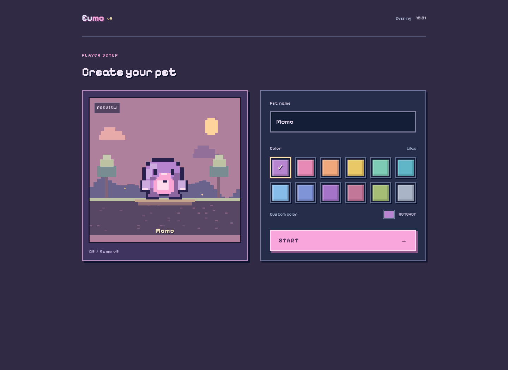
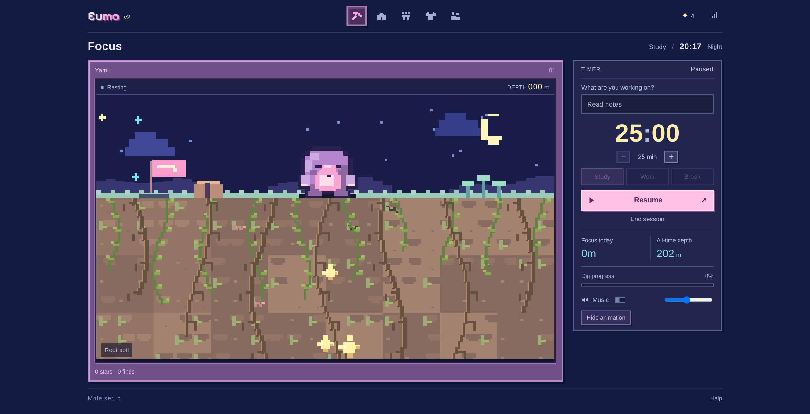

# Eumo v3

A retro pixel focus companion. Study or work while your mole digs, collect treasures, dress your companion, and decorate an underground home.

**[Play on the web →](https://1111-phi-ten.vercel.app/#focus)** · **[Download for Windows or Mac →](https://github.com/zhenyaowang0401/1111/releases/latest)**



## Downloads

| Platform | Installer |
| --- | --- |
| Windows 10 / 11 · x64 | [Download .exe](https://github.com/zhenyaowang0401/1111/releases/latest/download/Eumo-Windows-x64-Setup.exe) |
| macOS · Apple silicon | [Download .dmg](https://github.com/zhenyaowang0401/1111/releases/latest/download/Eumo-macOS-arm64.dmg) |
| macOS · Intel | [Download .dmg](https://github.com/zhenyaowang0401/1111/releases/latest/download/Eumo-macOS-x64.dmg) |

The desktop apps share the web game's features and artwork. Their floating mole uses a native, draggable, always-on-top window **without a browser address bar**. Closing the main window while the mole is floating hides the main window and keeps the session running.

Installers, ZIP alternatives, release notes, and checksums are available on [GitHub Releases](https://github.com/zhenyaowang0401/1111/releases/latest). The first desktop release has no Windows publisher certificate or Apple Developer ID signature/notarization; your operating system may ask you to confirm opening it. See the [desktop guide](docs/DESKTOP.md) for installation, progress transfer, and build instructions.

## Your focus companion

- **Focus:** Study, Work, and Break modes; adjustable 5–120 minute sessions; pause, resume, or finish early. The mole digs while you focus and rests when you rest.
- **Explore:** Follow your mole underground and revisit the already-dug tunnel after pausing or ending a session. Deeper layers introduce stone, sand, slate, granite, crystals, and basalt.
- **Collect:** Earn stars and discoveries through active focus time. Find rare golden collectibles, display them at home, or sell them for stars.
- **Dress up:** Mix hats, glasses, scarves, and small accessories. Digging tools have their own artwork and animations, with equal reward rates.
- **Make a home:** Decorate connected underground rooms, buy furniture, craft permanent decorations from spare finds, and manage treasures in your chest. Decorating keeps the home preview and item browser visible together on supported layouts.
- **Keep company:** Add real friends using friend codes and see their shared status and mole appearance. Friend requests and online summaries use the configured backend.
- **Reflect:** Review Study and Work totals, tasks, optional outcomes, trends, and a calendar. Finish the day to bring your mole back to the surface.
- **Listen:** Play soft music, groove, or white noise in the retro music room. Playback starts only when you choose it.
- **Chat:** Optional cloud chat supports questions, planning, and conversation with your mole. It requires an internet connection and a server-side provider key.

The interface supports English and Simplified Chinese. Choose a language in Mole setup; the app remembers it on the current device. A short, optional onboarding tour is available after setup and from Help.



## Floating mole

**Desktop app:** Open Float mole from Focus. Drag the name area to move the frameless window, resize it as needed, and use its controls to start, pause, resume, or end a session. The return icon brings back the main window; × closes only the floating window. Use the application menu's Quit command to exit completely.

**Web app:** Desktop Chrome and Edge can open a Document Picture-in-Picture window. Keep the original Eumo tab open. Closing the small window does not end the session; closing or refreshing the original tab closes the small window. The browser controls its title bar and placement, so the web version retains browser chrome. Unsupported browsers show an explanation.

Both versions display the same mole, equipment, tunnel, timer, and depth. They share the main view's session state and do not create a second reward counter.

## Voice input

Click the microphone inside either chat input to dictate, then click again to finish. The first use asks for microphone access. Short recordings (up to 45 seconds) are sent to the speech service, and the transcript is added to your draft for review before you press Send. This works on the HTTPS website and desktop apps with microphone access and an internet connection. Eumo does not save audio recordings.

The server reuses `AI_API_KEY` and `AI_BASE_URL` by default with SiliconFlow's `FunAudioLLM/SenseVoiceSmall` model. For another OpenAI-compatible transcription provider, configure `VOICE_API_KEY`, `VOICE_BASE_URL`, and `VOICE_MODEL` in the server environment; never add keys to browser or desktop files. A provider that only supports text chat will need these voice settings. Local file downloads cannot connect to transcription; use the website or desktop app.

## Progress and rewards

- Study and Work earn **1 metre per 30 active seconds**, **1 star per 5 active minutes**, and **1 discovery per 10 active minutes**. Partial progress carries across sessions.
- Pausing and Break do not earn digging rewards. Ending early keeps the time and rewards already recorded.
- Each regular ten-minute discovery has a **3% total bonus chance** of a golden collectible. Keep it, display it, or sell it for **99 stars**. Demo and Break are excluded.
- The repeatable **15-second developer demo** grants 5 metres, 1 spendable star, and 1 discovery. It is excluded from formal focus reports.
- Craft decorations with spare mushrooms, crystals, fossils, and star fragments. Displayed materials are reserved; crafting does not spend stars. Crafted decorations remain yours to move for free.
- Pet the idle mole to make it jump; three quick taps trigger a full spin. An active or paused session disables petting.

Finishing the day preserves lifetime depth, rewards, inventory, and history. A new device-local day begins at the surface once no session is active; sessions crossing midnight are not interrupted.

## Save and move your progress

Game progress is stored locally. The web app and desktop app have separate storage and **do not automatically sync**.

To move progress, pause your session and open **Help → Move / back up progress**. Export a JSON backup, then import it on the other device. Importing replaces that device's progress after confirmation. Chat history and friend credentials are not included; reconnect friends separately on the new client.

Friend relationships and shared summaries use the configured database. Task text and AI conversations are not shared with friends. Browser identity uses an HttpOnly cookie; a friend code is not a login credential.

Clearing browser site data or application data can remove local progress. Export a backup before clearing data or uninstalling.

## Offline web download

1. On GitHub, select **Code → Download ZIP**.
2. Extract the ZIP to a folder on your computer.
3. Open **`dist/Eumo.html`** in Chrome or Edge.
4. Name your mole, choose a color, and select **START**.

The standalone HTML includes styles, scripts, pixel artwork, fonts, and music. Local gameplay needs no Node.js or npm installation. Online chat and friends still require their backend services. GitHub's HTML file viewer displays source code; download and open the file to play.

## Local development

For static gameplay, serve the repository with Python:

```sh
python3 -m http.server 8000
```

On Windows, `py -m http.server 8000` also works. Open `http://localhost:8000/` in your browser. Use the same browser and origin to retain local progress.

For the local API development server or desktop app, use Node.js 22:

```sh
npm ci
npm run dev
# Or launch the desktop app:
npm run desktop:dev
```

Configure provider and database credentials on the server only. The active web deployment is **https://1111-phi-ten.vercel.app**. The older `1111-alpha-nine.vercel.app` deployment has separate environment settings and local browser storage; pushing code does not transfer credentials or saves between deployments.

After changing web source files, rebuild all standalone entry points:

```sh
python3 scripts/build_standalone.py
```

This updates `dist/Eumo.html` and the identical compatibility copies `dist/Supermo.html` and `dist/LOOP_PET.html`. Commit generated files alongside the source changes. Desktop web assets are generated separately by `npm run desktop:prepare` and are not committed.

## Testing

Run checks relevant to the change. Desktop checks include:

```sh
npm run test:desktop
npm run test:desktop:smoke
```

The native-window smoke test requires a graphical desktop. Windows and macOS builds run it in GitHub Actions before publishing installers.

Browser tests use Python 3.10+, Playwright, and Chromium:

```sh
python3 -m venv .venv
# Activate the virtual environment, then:
python -m pip install -r requirements-dev.txt
python -m playwright install chromium
python tests/test_entry.py
python tests/test_site.py
```

Additional checks cover rewards, crafting, reports, device time, viewports, friends, chat, and floating windows. See the [testing guide](docs/TESTING.md) and [validation notes](docs/VALIDATION.md). Database tests require `npm ci`; run them with `npm run test:friends`.

## Project structure

| Path | Purpose |
| --- | --- |
| `index.html`, `style.css`, `app.js` | Web entry point, layout, game state, navigation, and timer |
| `pixel-art.js`, `wardrobe-art.js`, `terrain.js` | Shared pixel character, equipment, and terrain rendering |
| `home.js`, `wardrobe.js`, `journey.js` | Home decoration, equipment, discoveries, and rewards |
| `chat.js`, `api/`, `ai/` | Chat interface, server endpoints, prompts, and evaluation scenarios |
| `audio.js`, `assets/` | Audio playback, music, artwork, and local fonts |
| `desktop/` | Electron windows, secure resource loading, and release notes |
| `save-transfer.js` | Portable progress export and import |
| `dist/Eumo.html` | Standalone offline web build |
| `scripts/`, `tests/` | Build tools and automated checks |
| `docs/` | Product, design, setup, deployment, and development notes |

## Documentation

[Desktop apps](docs/DESKTOP.md) · [Product](docs/PRODUCT.md) · [V3 features](docs/V3.md) · [Friends setup](docs/FRIENDS_SETUP.md) · [Music](docs/MUSIC.md) · [AI setup](docs/AI_SETUP.md) · [Model research](docs/AI_RESEARCH.md) · [Persona prompts](docs/AI_PROMPTS.md) · [Architecture](docs/ARCHITECTURE.md) · [Deployment](docs/DEPLOYMENT.md) · [Troubleshooting](docs/TROUBLESHOOTING.md) · [Development log](docs/DEVLOG.md)

[Changelog](CHANGELOG.md) · [Contributing](CONTRIBUTING.md) · [Build status](https://github.com/zhenyaowang0401/1111/actions/workflows/desktop-release.yml)
