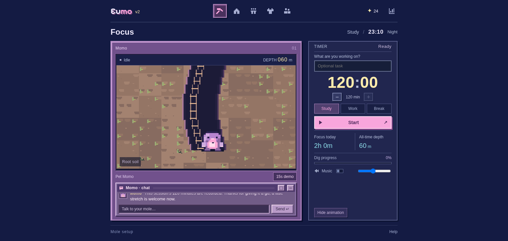
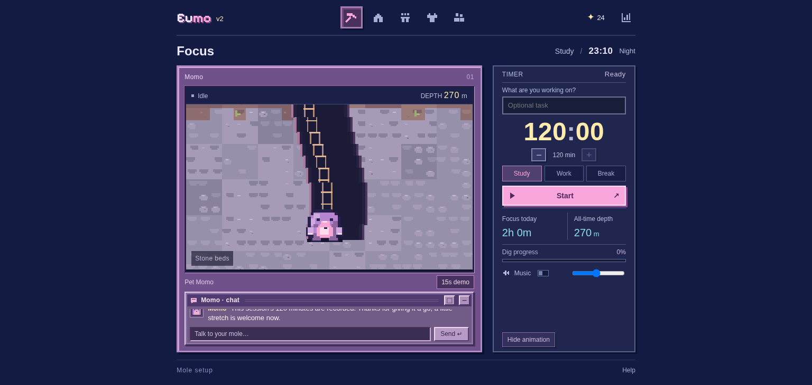
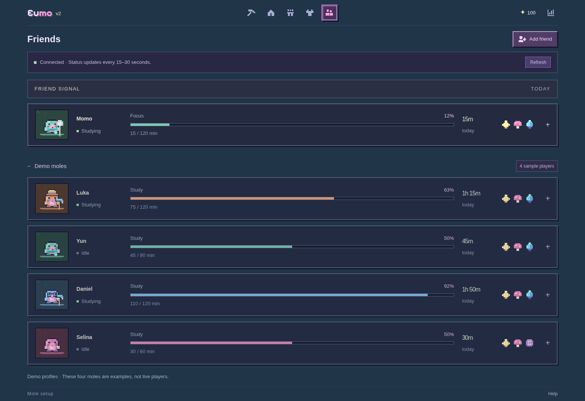
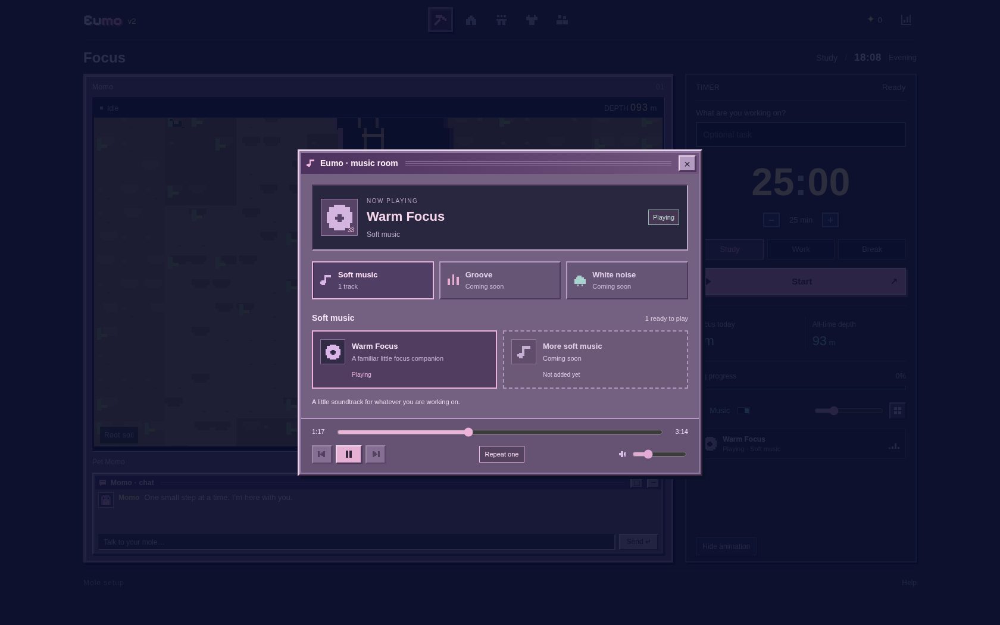
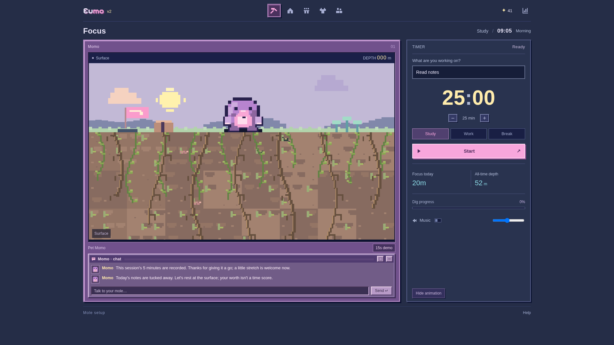
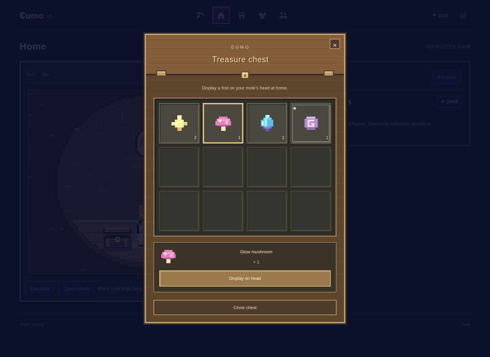
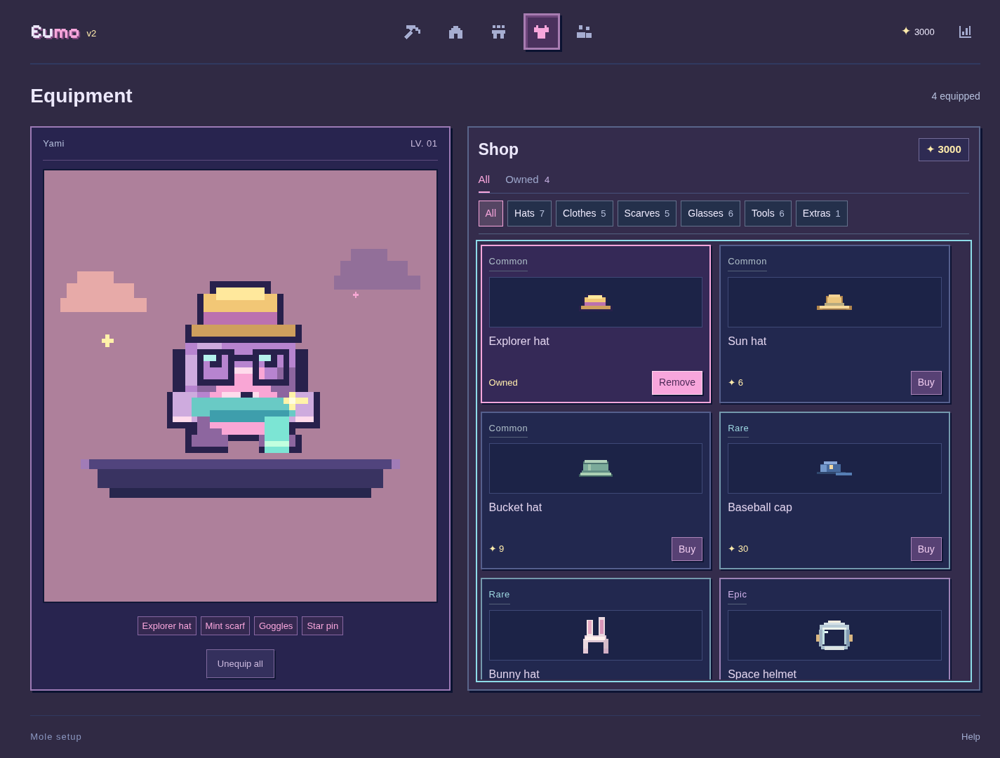

# Eumo v2

**[在线打开 Eumo →](https://1111-phi-ten.vercel.app/#focus)**

当前使用的 Vercel 项目网址是 **https://1111-phi-ten.vercel.app**，AI 密钥配置在这个项目中。旧入口 `1111-alpha-nine.vercel.app` 使用另一份部署配置；更新 GitHub 代码不会把新项目的密钥同步到旧站。

游戏进度保存在各网址自己的浏览器存储里，切换网址不会自动迁移旧站进度。

一个英文界面的像素专注小游戏：创建自己的无耳朵鼹鼠，专注时向下挖洞，收集宝物、叠穿装备，布置洞穴家园，并查看每日任务报告。

[联网好友配置](docs/FRIENDS_SETUP.md) · [音乐库与添加音频](docs/MUSIC.md) · [AI 云端接入](docs/AI_SETUP.md) · [模型选型](docs/AI_RESEARCH.md) · [鼹鼠提示词](docs/AI_PROMPTS.md) · [English](docs/README.en.md) · [功能说明](docs/PRODUCT.md) · [技术与数据结构](docs/ARCHITECTURE.md) · [测试方法](docs/TESTING.md) · [常见问题](docs/TROUBLESHOOTING.md) · [开发记录](docs/DEVLOG.md)


## 下载到电脑并打开

**请在 GitHub 仓库页面操作：**

1. 点击绿色 **Code → Download ZIP**。
2. 将下载的 ZIP **解压到电脑文件夹**。
3. 在解压后的文件夹里进入 `dist`，找到 **`Eumo.html`**。
4. 用 Chrome 或 Edge 打开它，填写宠物名字、选择颜色，再点击 **START**。

`dist/Eumo.html` 已包含完整样式、脚本、像素字体、像素绘制和声音，不需要安装 Node.js、npm 或其他运行依赖。

> GitHub 中点击 HTML 文件会看到源码，这是正常的源码浏览界面。请下载、解压后在浏览器中打开文件，或按下面的方法运行本地服务。聊天里的文件预览器也不等于下载到电脑。

## 本地开发

在解压后的项目根目录运行：

```sh
python3 -m http.server 8000
```

Windows 如果使用 Python 启动器：

```powershell
py -m http.server 8000
```

然后在浏览器访问 `http://localhost:8000/`。开发时修改根目录源码；运行应用无需安装 Python 包。这个 Python 服务只提供静态游戏；AI 开发使用 `npm run dev`，云端需按 [AI 接入步骤](docs/AI_SETUP.md) 配置 Vercel 服务端 Key。固定使用同一个浏览器和服务地址，便于保留本地进度。

## 当前功能

| 页面 / 系统 | 已实现的内容 |
| --- | --- |
| 宠物创建 | 命名、12 种大块颜色预设、自选颜色、实时像素预览；修改外观不重置进度 |
| 专注与挖洞 | Study / Work / Break，5–120 分钟，增减时间、暂停、继续、提前结束；矿道随计时挖深，镜头向下跟随 |
| 宠物互动 | 无耳朵造型、待机眨眼、困倦、带 zzz/鼻涕泡/呼吸的睡觉；空闲时点击角色会跳跃、发出两声“嘟嘟”并显示 `yeeeeee`；进行中和暂停的任务都不能抚摸 |
| 宝库与装备 | 星星结算、四种发现物、背包数量；帽子 7 款、衣服 5 款、围脖 5 款、眼镜 6 款，分类搭配；6 种付费工具只在挖掘时显示 |
| 家园 | 第二个小房子入口、圆形土洞、四个摆放位、家具购买、可点击宝箱、头顶展示发现物（仅家园）、四种房间主题 |
| 鼹鼠 AI | 可部署的 Qwen 云端聊天接口、真实任务/时长/装备上下文、答疑与规划提示词、可选共享、完整对话窗口与本地历史；尚需配置服务端 Key 才能真实聊天 |
| 今日报告 | Study / Work 分类时间、任务与可选成果、7 / 30 日趋势、日历、醒目的 Finish 与今日返地面 |
| 时间联动 | 自动读取设备本地时间和时区；清晨、白天、傍晚、夜晚四种背景 |
| 好友 | 好友码、双向请求/接受、删除、真实状态与鼹鼠同步、共享开关；需配置 Supabase 后上线。原四只演示鼹鼠独立保留 |
| 声音 | 紫色复古 Music room，轻音乐/律动/白噪音分类；播放、进度、上下首、循环与音量；现有 Warm Focus 可播放，其余留作后续音频；不会自动播放 |

**真实好友功能需先完成 [Supabase 配置](docs/FRIENDS_SETUP.md)。** 原来的四只示例鼹鼠保留在 Demo moles 区域，明确不是在线玩家。好友关系和已同意共享的摘要在数据库中；游戏进度仍保存在当前浏览器，没有账号云存档。浏览器好友身份用 HttpOnly cookie 保留，好友码不能当作登录凭据。


Focus 桌面采用约 72:28 的左右面板，两块上下对齐；左侧矿洞下方是紫色复古 Windows 风格的 Mole chat：可收起、展开，点击方框打开完整对话，支持闲聊、学习答疑和日程建议。换装/共学台词本地即时触发；主动发消息才请求云端 AI。接口已写好，真实聊天需要在 Vercel 配置服务商 Key，当前没有宣称已完成真实模型验证。矮屏优先保留可读的计时与完整操作。

普通挖掘前 2 小时（240 米前）一直是泥土，浅层有藤蔓和树根，深一些土色略变。2 小时才见柔和的淡紫灰石层，2.5 小时进入沙层，之后依次经过板岩、粉褐花岗岩、晶矿和玄武岩。镜头不会提前露出未到达的地层。





## 真实好友

Friends 页右上角的加好友按钮提供自己的可复制好友码、发送/接受/拒绝/撤回请求和删除好友。成为双向好友后，卡片显示真实专注时间、在线/离线/暂停/休息状态及鼹鼠颜色、装备、工具和睡眠情况。任务和 AI 对话不共享；可暂停状态共享。



需要一次数据库配置才能在线使用；详见 [好友接入步骤与身份范围](docs/FRIENDS_SETUP.md)。

## 音乐库

点击 Music 右边的四格图标打开紫色复古音乐窗口。Soft music（轻音乐）里已有 Warm Focus；Groove（律动）和 White noise（白噪音）已留好分类和曲目位置，音频完成后再添加。未添加的内容显示 Coming soon，不能误点播放。



播放器支持共享音量、可用曲目的上下首、进度和循环；关闭窗口、浏览分类和切换页面都不打断学习。新增音频的配置与打包方法见 [音乐说明](docs/MUSIC.md)。

## 玩法与结算

- Study / Work 每 30 秒挖 1 米，每累计 5 分钟收集 1 星，每 10 分钟收集一件发现物；实际经过路径自动拾取。
- 零头跨轮保留；暂停、Break 不产奖励，没有连续倍率或每日硬上限。
- **15 秒开发者 Demo 保留每轮奖励**：5 米、1 星、1 件物品，进入同一余额与背包，方便测试家具和装备。
- 提前结束保存实际时间、深度和已拿到的奖励；Demo 不计入正式报告。
- 家园有免费地垫、6 件可购买家具和 3 个付费星星主题，发现物可直接摆放。
- 右上角 Today 可查看报告或选择 Finish。确认结束后保存成果并让鼹鼠回到地面；只查看或取消不重置矿道，累计深度和奖励保留。下一天从新的浅土矿道开始；跨午夜进行中的任务结束后才返地面。




## 分类穿戴与工具

| 分类 | 数量 | 星星价格 |
| --- | ---: | --- |
| 帽子 | 7 | 3–120 |
| 衣服 | 5 | 12–40 |
| 围脖 | 5 | 3–38 |
| 眼镜 | 6（含原护目镜） | 2–45 |
| 付费工具 | 6 | 45–240 |

帽子、衣服、围脖、眼镜各选一件，可跨类别搭配；旧眼镜归入 Glasses，胸针保留在 Extras。新增墨镜、圆框、方框、爱心框和星形框，价格分别为 6、8、10、24、45 星。工具单独选择，不出现在试衣预览里，默认镐子无需购买。工具只有造型和动画差异，不改变奖励或挖掘速度。已购买物品重新选择不收费。

家园宝箱采用木箱、金属搭扣和物品格子：点物品，再点 **Display on head**；发现物不会在矿洞或试衣页面显示。





商店左侧固定预览鼹鼠，右侧商品区独立滚动；支持鼠标滚轮、拖动滚动条、键盘滚动和触摸滑动，分类栏一直可见。手机将预览压缩到商店上方。正文、按钮和数字使用清晰的系统字体，小字一般为 12–14px，计时使用等宽数字、取消像素阴影；仅 Logo 保留本地 Pixelify Sans，使用 [SIL OFL 1.1 许可](assets/fonts/OFL.txt)。桌面同时按浏览器的可用宽度和高度控制画面：100% 缩放下完整显示游戏、侧栏和底部按钮，避免只按宽度铺大。短屏收紧间距并调整控制排列，计时仍至少 44px，Canvas 保持比例；手机与平板保留纵向滚动。

## 修改源码后生成单文件

```sh
python3 scripts/build_standalone.py
```

这会重新生成 `dist/Eumo.html`，并更新内容完全相同的旧文件名 `dist/Supermo.html` 和 `dist/LOOP_PET.html` 作为兼容入口。请同时提交源码与更新后的单文件，避免下载版落后于开发版。

## 自动化测试

测试依赖与游戏运行依赖分开。好友数据库测试先运行 `npm ci` 安装开发用 PostgreSQL 引擎；浏览器测试使用 Python 3.10+：

```sh
python3 -m venv .venv
```

激活虚拟环境后：

```sh
python -m pip install -r requirements-dev.txt
python -m playwright install chromium
python tests/test_entry.py
python tests/test_site.py
python tests/test_world.py
python tests/test_journey.py
python tests/test_supermo.py
python tests/test_eumo.py
python tests/test_daily.py
python tests/test_viewport.py
python tests/test_geology.py
python tests/test_chat.py
python tests/test_companion.py
python tests/test_music.py
python tests/test_friends_browser.py
npm run test:friends
node --test tests/test_ai.cjs
node tests/test_rewards.js
```

Linux 系统若缺少浏览器系统库，可使用 Playwright 官方安装命令 `python -m playwright install --with-deps chromium`。已有系统 Chromium 会被自动复用；也可以设置 `PLAYWRIGHT_CHROMIUM_EXECUTABLE`。

测试覆盖内嵌预览中的 START、中文名称与回车、无耳朵图形、抚摸反应、叠穿、挖掘结算、学习报告、跨午夜、设备时区、同伴卡片和手机布局。详见 [测试文档](docs/TESTING.md)。

## 发布为可点击的网址

此项目可以部署到 GitHub Pages。仓库所有者可进入 **Settings → Pages**，选择 **Deploy from a branch → main → /(root)**，保存后等待 GitHub 完成部署，再使用该页面显示的网址。

**提交代码不等于已经启用 Pages。** 本仓库文档不会把未部署的地址标为可用网站。[部署说明](docs/DEPLOYMENT.md) 包含启用步骤和检查方法。

## 项目目录

```text
.
├── index.html                 # 多文件网页入口
├── style.css                  # 像素风与响应式界面
├── app.js                     # 状态、计时、导航、报告与同伴
├── chat.js                    # 聊天窗口、上下文与本地陪伴反应
├── api/chat.js                # Vercel 服务端模型代理
├── ai/                        # 系统提示词、示范、SFT 种子与评测场景
├── pixel-art.js               # 无耳朵角色、矿道、动画与配色
├── world.js                   # 设备时间与昼夜背景
├── audio.js                   # MP3 播放与两声宠物叫声
├── journey.js                 # 路径、累计奖励与拾取事件
├── home.js                    # 家具、主题和摆放位置
├── wardrobe.js                # 分类、价格与装备存档校验
├── wardrobe-art.js            # 穿戴与六种工具的共用像素模型
├── terrain.js                 # 土层色块、石子、根系与地下生态
├── assets/audio/              # 原始 Warm Focus MP3
├── assets/fonts/              # Pixelify Sans 字体与 OFL 许可
├── dist/Eumo.html          # 可离线打开的单文件
├── scripts/build_standalone.py # 可重复的单文件构建
├── tests/                     # 十套浏览器测试与奖励规则检查
├── docs/                      # 产品、技术、部署和问题排查
├── requirements-dev.txt        # 仅测试使用
└── 349f8aa35697822105fd0040f35a68bd.mp4  # 仓库原有视频，保留
```

## 当前限制

- 没有真实联机、登录、跨设备同步或排行榜服务。AI 接口是单独的可选功能，服务商会收到主动发送的聊天及所共享摘要；Key 仅放服务端，云端调用可能收费。
- 浏览器清理站点数据会清除本地记录；直接打开 `file://` 时的存储行为取决于浏览器。
- 限制存储的内嵌预览仍可交互，但关闭后可能不保留记录。
- 音乐为用户提供的 MP3，宠物叫声为程序合成；只有用户操作后才启动音频。

[更新记录](CHANGELOG.md) · [贡献说明](CONTRIBUTING.md)
