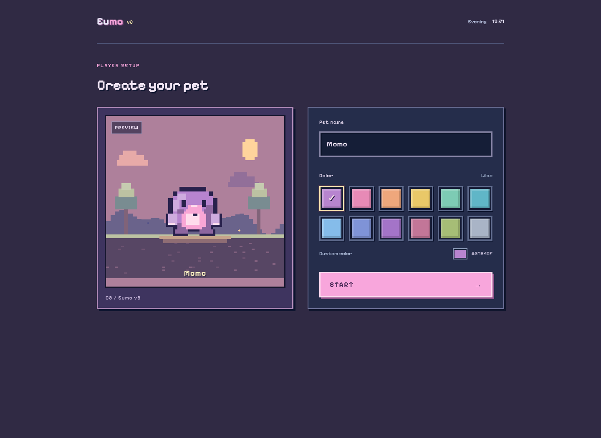
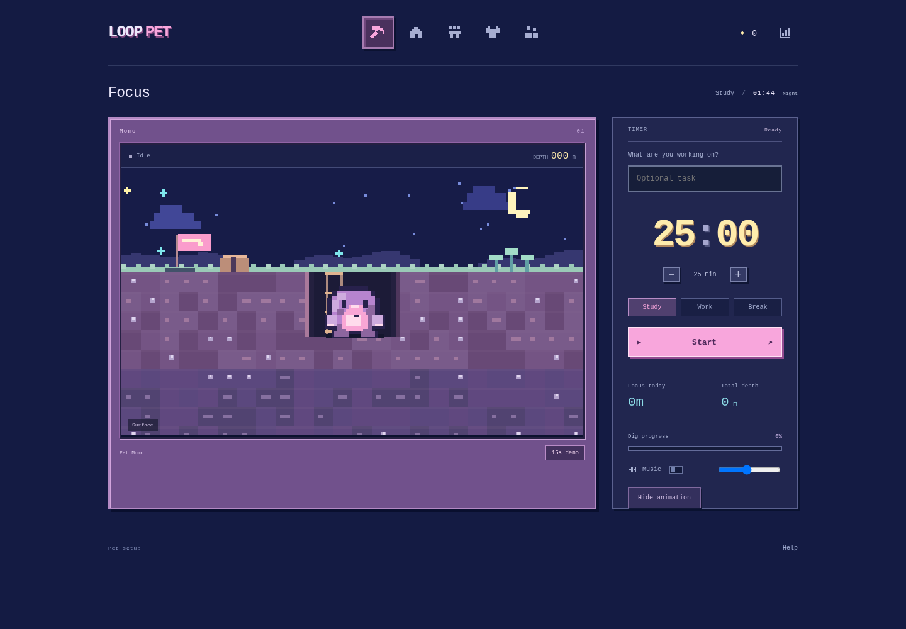
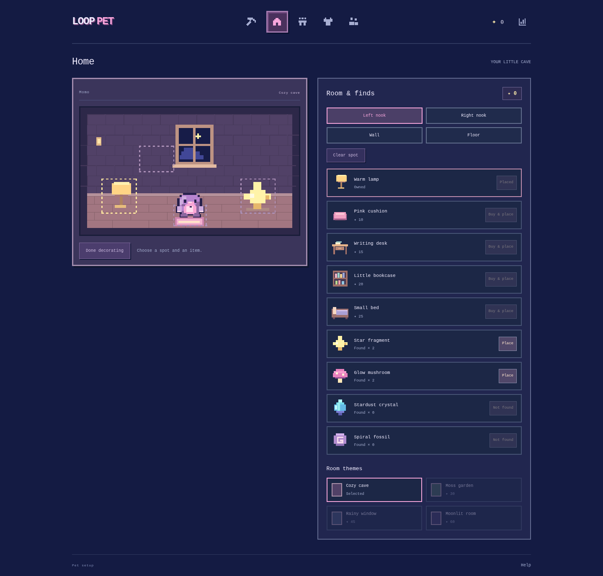

# LOOP PET

一个英文界面的像素专注小游戏：创建自己的无耳朵鼹鼠，专注时向下挖洞，收集宝物、叠穿装备，布置洞穴家园，并查看每日任务报告。

[English](docs/README.en.md) · [功能说明](docs/PRODUCT.md) · [技术与数据结构](docs/ARCHITECTURE.md) · [测试方法](docs/TESTING.md) · [常见问题](docs/TROUBLESHOOTING.md)



## 下载到电脑并打开

**请在 GitHub 仓库页面操作：**

1. 点击绿色 **Code → Download ZIP**。
2. 将下载的 ZIP **解压到电脑文件夹**。
3. 在解压后的文件夹里进入 `dist`，找到 **`LOOP_PET.html`**。
4. 用 Chrome 或 Edge 打开它，填写宠物名字、选择颜色，再点击 **START**。

`dist/LOOP_PET.html` 已包含完整样式、脚本、像素绘制和声音，不需要安装 Node.js、npm 或其他运行依赖。

> GitHub 中点击 HTML 文件会看到源码，这是正常的源码浏览界面。请下载、解压后在浏览器中打开文件，或按下面的方法运行本地服务。聊天里的文件预览器也不等于下载到电脑。

## 本地开发

在解压后的项目根目录运行：

```sh
python3 -m http.server 8000
```

Windows 如果使用 Python 启动器：

```powershell
py -m http.server 8000
```

然后在浏览器访问 `http://localhost:8000/`。开发时修改根目录源码；运行应用无需安装 Python 包。固定使用同一个浏览器和服务地址，便于保留本地进度。

## 当前功能

| 页面 / 系统 | 已实现的内容 |
| --- | --- |
| 宠物创建 | 命名、12 种大块颜色预设、自选颜色、实时像素预览；修改外观不重置进度 |
| 专注与挖洞 | Study / Work / Break，5–120 分钟，增减时间、暂停、继续、提前结束；矿道随计时挖深，镜头向下跟随 |
| 宠物互动 | 无耳朵造型、待机眨眼、困倦和睡觉；空闲时点击角色会跳跃、发出两声“嘟嘟”并显示 `yeeeeee`；进行中和暂停的任务都不能抚摸 |
| 宝库与装备 | 星星结算、四种发现物、背包数量；四件装备可同时穿戴，并显示在实际矿洞中 |
| 家园 | 第二个小房子入口、四个摆放位、家具购买、发现物展示、四种房间主题 |
| 今日报告 | Study / Work 分类时间、任务与可选成果、7 / 30 日趋势、日历、今天结束和 JSON 导出 |
| 时间联动 | 自动读取设备本地时间和时区；清晨、白天、傍晚、夜晚四种背景 |
| 同伴 | Luka、Yun、Daniel、Selina 四个不同配色的示例玩家，学习进度条、学习时长、可展开的发现物 |
| 声音 | 用户提供的 Warm Focus MP3 循环、音量调节、两声抚摸叫声；不会自动播放 |

**同伴目前是明确标注的示例资料，尚未连接真实玩家、账号或在线状态。** 全部个人进度保存在当前浏览器的 `localStorage`，没有云同步。



## 玩法与结算

- Study / Work 每 30 秒挖 1 米，每累计 5 分钟收集 1 星，每 10 分钟收集一件发现物；实际经过路径自动拾取。
- 零头跨轮保留；暂停、Break 不产奖励，没有连续倍率或每日硬上限。
- **15 秒开发者 Demo 保留每轮奖励**：5 米、1 星、1 件物品，进入同一余额与背包，方便测试家具和装备。
- 提前结束保存实际时间、深度和已拿到的奖励；Demo 不计入正式报告。
- 家园有免费地垫、6 件可购买家具和 3 个付费星星主题，发现物可直接摆放。
- 右上角 Today 可查看报告或选择 Finish today。单纯打开报告不会停止计时。



## 修改源码后生成单文件

```sh
python3 scripts/build_standalone.py
```

这会重新生成 `dist/LOOP_PET.html`。请同时提交源码与更新后的单文件，避免下载版落后于开发版。

## 自动化测试

测试依赖与游戏运行依赖分开。使用 Python 3.10+：

```sh
python3 -m venv .venv
```

激活虚拟环境后：

```sh
python -m pip install -r requirements-dev.txt
python -m playwright install chromium
python tests/test_entry.py
python tests/test_site.py
python tests/test_world.py
python tests/test_journey.py
node tests/test_rewards.js
```

Linux 系统若缺少浏览器系统库，可使用 Playwright 官方安装命令 `python -m playwright install --with-deps chromium`。已有系统 Chromium 会被自动复用；也可以设置 `PLAYWRIGHT_CHROMIUM_EXECUTABLE`。

测试覆盖内嵌预览中的 START、中文名称与回车、无耳朵图形、抚摸反应、叠穿、挖掘结算、学习报告、跨午夜、设备时区、同伴卡片和手机布局。详见 [测试文档](docs/TESTING.md)。

## 发布为可点击的网址

此项目可以部署到 GitHub Pages。仓库所有者可进入 **Settings → Pages**，选择 **Deploy from a branch → main → /(root)**，保存后等待 GitHub 完成部署，再使用该页面显示的网址。

**提交代码不等于已经启用 Pages。** 本仓库文档不会把未部署的地址标为可用网站。[部署说明](docs/DEPLOYMENT.md) 包含启用步骤和检查方法。

## 项目目录

```text
.
├── index.html                 # 多文件网页入口
├── style.css                  # 像素风与响应式界面
├── app.js                     # 状态、计时、导航、报告与同伴
├── pixel-art.js               # 无耳朵角色、矿道、动画与配色
├── world.js                   # 设备时间与昼夜背景
├── audio.js                   # MP3 播放与两声宠物叫声
├── journey.js                 # 路径、累计奖励与拾取事件
├── home.js                    # 家具、主题和摆放位置
├── assets/audio/              # 原始 Warm Focus MP3
├── dist/LOOP_PET.html          # 可离线打开的单文件
├── scripts/build_standalone.py # 可重复的单文件构建
├── tests/                     # 四套浏览器测试与奖励规则检查
├── docs/                      # 产品、技术、部署和问题排查
├── requirements-dev.txt        # 仅测试使用
└── 349f8aa35697822105fd0040f35a68bd.mp4  # 仓库原有视频，保留
```

## 当前限制

- 没有真实联机、登录、跨设备同步或排行榜服务。
- 浏览器清理站点数据会清除本地记录；直接打开 `file://` 时的存储行为取决于浏览器。
- 限制存储的内嵌预览仍可交互，但关闭后可能不保留记录。
- 音乐为用户提供的 MP3，宠物叫声为程序合成；只有用户操作后才启动音频。

[更新记录](CHANGELOG.md) · [贡献说明](CONTRIBUTING.md)
