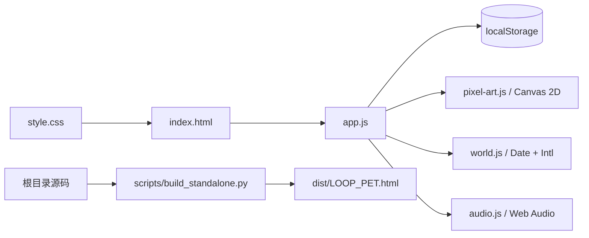

# 技术与数据结构

## 技术栈

应用使用原生 HTML、CSS、JavaScript、Canvas 2D 与 Web Audio，无前端框架、打包器、CDN、运行时包依赖或后端。Python 用于开发服务、生成单文件和浏览器测试。

## 模块职责

| 文件 | 职责 |
| --- | --- |
| `index.html` | 创建页、五个游戏页、对话框、像素图标定义、无障碍名称 |
| `style.css` | 像素边框、页面布局、响应式断点、四个时段的主题与减少动态效果 |
| `app.js` | 单一状态对象、输入清理、导航、计时与学习记账、奖励、装备、报告、同伴资料及交互 |
| `pixel-art.js` | 角色与物品的整数网格绘制、挖掘矿道、镜头、眨眼、跳跃和角色点击范围 |
| `world.js` | 设备本地时间、时区和 Morning / Day / Evening / Night 色板 |
| `audio.js` | 音频上下文、立体声雨滴循环、音量和抚摸叫声 |

## 导航与内嵌预览兼容

页面标识为 `start`、`focus`、`rewards`、`wardrobe`、`reports`、`companions`。URL 片段用于直接访问与浏览器导航，页面内容本身由 JavaScript 切换显示。

`navigateTo()` **先渲染目标页，再尝试更新 History API**。即使预览容器禁止 URL 历史修改，界面仍可切换。普通链接被委托给这套导航；常规浏览器的前进/后退也有对应事件监听。

首次创建由显式 START 按钮触发。名字输入中的 Enter 走相同逻辑，并跳过输入法组合期间的 Enter。保留表单事件处理，但进入游戏不依赖浏览器允许原生表单提交。

这是已确认的兼容性修复：只给 iframe `allow-scripts`、不给 `allow-forms` 时，旧的原生提交入口会被浏览器阻止。当前实现不需要放宽 iframe 权限。

## 本地状态

存储键保持为 `loop-pet-soft-universe-v1`，以兼容早期存档。键名中的旧名称不代表当前视觉版本。

| 字段 | 用途 |
| --- | --- |
| `profile` | `{name, color, configured}`，宠物名字、身体颜色与创建状态 |
| `depth` | 已完成并结算的累计深度 |
| `inventory` | 四种发现物的数量数组，顺序见产品文档 |
| `balance` | 星星余额 |
| `owned` | 已购买装备 ID 数组 |
| `equipped` | 同时穿戴的装备 ID 数组 |
| `sessions` | 已完整完成的全部类型任务数 |
| `totalSeconds` | 已完整完成任务的累计时长，包括非 Study 类型和试玩 |
| `history` | 完成或提前结束的记录，包含类型、时间、结果、奖励与跨日分配 |
| `session` | 当前任务或 `null`，包含运行/暂停状态、计划时长、截止时间、剩余时间等 |
| `minutes` / `mode` | 下次任务设置 |
| `reportDays` | 按本地日期聚合的 `{seconds, completed}`；只统计实际 Study 时间 |
| `rainVolume` | 0–1 的音量设置；不保存“自动播放”意图 |

注意 `totalSeconds` 与报告总学习时间的口径不同。报告应读取 `reportDays`，不要把所有任务时间当成学习时间。

## 计时与学习记账

- 运行中的剩余时间由 `deadline - Date.now()` 计算，不通过定时器回调次数累加。
- 暂停时固定剩余时间；恢复时创建新的截止时间。
- `trackStudy()` 记录上次计入点到当前时间的有效 Study 区间，并限制到任务截止时间。
- 跨午夜的区间按设备本地日期切分，写入 `reportDays` 和任务的 `studyDays`。
- 完成或提前结束时，历史记录保留这份按日时长，供日历日志显示。
- 后台返回、页面离开和任务交互都会更新记录；运行中的任务定期尝试持久化。

设备时间也是计时的时间基准，当前没有独立的服务器校时或反作弊机制。

## 迁移与存储不可用

读取时会过滤未知装备 ID，旧版单件 `equipped` 字符串会迁移为数组；旧记录缺少报告聚合时，可从仍然存在的 Study 历史重建。已经丢失的历史无法凭空恢复。

禁用存储或不提供同源存储的内嵌预览仍能以内存状态运行，但不能承诺刷新或关闭后保留。推荐固定 HTTP 地址使用；切换浏览器、站点、协议或端口可能得到独立存档。

## 像素绘制

角色、矿道和物品通过 Canvas 矩形与整数网格绘制；CSS 使用 `image-rendering: pixelated` 保持像素边缘。各场景调用同一个无耳朵角色函数，身体色与装备作为参数传入，避免创建页和实际游戏形象不一致。

动画由 `requestAnimationFrame` 驱动并限速。抚摸通过角色绘制范围做命中检测。系统减少动态效果偏好会抑制跳跃；挖掘进度仍按计时更新。

## 离线单文件

构建脚本按页面既有顺序内嵌 `world.js`、`audio.js`、`pixel-art.js`、`app.js` 和 `style.css`。数据 URI 图标、程序绘制图像和合成声音无需额外资源。

`dist/LOOP_PET.html` 是可重建的生成文件。请不要单独修改它；修改源码后重新构建，并一起提交。
