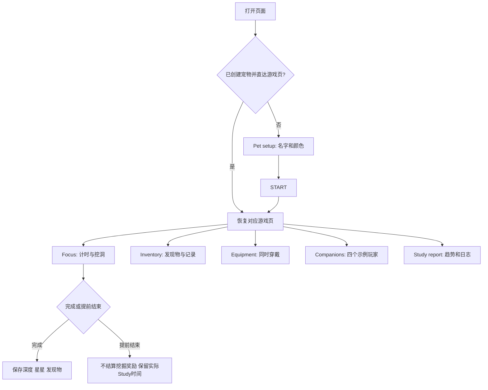

# 产品与交互说明

## 产品范围

LOOP PET 是本地单用户像素专注原型，界面语言为英文。用户创建一个无耳朵鼹鼠，通过专注计时推进挖掘，并用奖励装备宠物。报告用于回顾当前浏览器记录的实际学习时间。

以下内容已实现，不代表有服务器或真实联网能力。

## 页面流程

新用户必须先创建宠物。已配置用户打开游戏页的 URL 片段（如 `#reports`）可直接恢复该页；打开无片段的根地址会回到已填好当前设置的 Start 页面。点击品牌或页脚的 **Pet setup** 可以重新编辑。

## 宠物预设

可编辑范围只有名字和身体颜色，不包含物种、耳朵、发型或身体形状。

- 名字最多 16 个字符；显示时使用文本节点，支持中文输入。
- 12 个预设：Lilac、Rose、Peach、Honey、Mint、Teal、Sky、Cobalt、Plum、Berry、Moss、Silver。
- 支持六位十六进制自选颜色，预览实时重绘。
- Start 保存；Back 丢弃未保存的编辑。
- 外观编辑不清空深度、货币、装备、报告或已有计时任务。

## 专注与挖掘

| 项目 | 当前行为 |
| --- | --- |
| 类型 | Study、Work、Break |
| 时长 | 5–120 分钟，普通时间按钮每次调整 5 分钟 |
| 正式挖掘 | 每 30 秒 1 米；矿道逐步被清开，镜头向下跟随 |
| 暂停 | 剩余时间和挖掘进度一起冻结 |
| 继续 | 从暂停点恢复 |
| 完成 | 保存本次深度；增加已完成任务数、星星和一件发现物 |
| 提前结束 | 丢弃当前未结算的深度、星星和发现物；之前完成的进度保持 |
| 15 秒试玩 | 每 3 秒 1 米，完整完成后结算 5 米、1 星和 1 件发现物 |
| 进行中加时 | 普通任务允许加 5 分钟；试玩不提供中途加时 |

正式挖掘的奖励为 `max(1, floor(计划秒数 / 300))` 颗星星。例如，25 分钟完整完成获得 5 颗星星。

计时使用设备的截止时间，后台恢复或刷新后重新计算剩余时间。当前没有服务器校时。

## 抚摸与动画

- 所有角色都使用无耳朵的阶梯状头部。
- 空闲时眨眼；挖掘时挥镐并出现土屑。
- 只点击角色本身才触发抚摸，点击天空或地面不触发。
- 空闲时抚摸会跳跃一次、播放短合成叫声、显示 `yeeeeee`。
- 存在正在进行或已暂停的任务时，主场景和装备页都禁用抚摸。
- 连续点击有短暂冷却；系统减少动态效果偏好会抑制跳跃。

## 宝库与装备

发现物依次循环：Star fragment → Glow mushroom → Stardust crystal → Spiral fossil。重复发现会增加数量；当前不是随机掉率系统。

| 装备 | 价格 | 行为 |
| --- | --- | --- |
| Goggles | 2 星 | 购买并穿戴；独立切换 |
| Explorer hat | 3 星 | 同上 |
| Mint scarf | 3 星 | 同上 |
| Star pin | 5 星 | 同上 |

四件可以同时穿戴，并在装备预览和矿洞角色中一起显示。提供单件 Remove 和 Unequip all；重复穿戴已拥有物品不会再次扣费。

## 学习报告

仅统计非试玩的 **Study 实际进行时间**：

- 统计进行中的学习时间；提前结束仍保留已进行的学习时间。
- 不包含暂停、Work、Break 或试玩。
- 以设备本地日期聚合；跨午夜按时间分别记入两天。
- 提供今日、本周（周一开始）、累计时长，以及 7 / 30 天趋势。
- 日历可切换月份，点击日期查看当天日志；未来日期不可选择。
- 已完成 Study 数与实际 Study 时长分别记录。

## 本地时间与背景

| 时段 | 设备本地时间 |
| --- | --- |
| Morning | 06:00–09:59 |
| Day | 10:00–16:59 |
| Evening | 17:00–19:59 |
| Night | 20:00–05:59 |

页面读取浏览器本地时钟与时区，不申请定位权限、不连接网络时间服务器。地表显示对应天空、太阳或月亮；深层矿道保留土层画面。

## 同伴系统的边界

Luka、Yun、Daniel、Selina 是固定示例资料，分别有桃色、薄荷绿、天蓝、玫瑰色鼹鼠。卡片展示示例学习时长、学习目标进度和发现物，展开后可看示例累计深度与物品数量。

**这些不是实时在线用户，也没有真实社交关系或共享学习记录。** 后续真实联机需要独立设计账号、授权、服务端存储和实时更新。

## 声音

雨声由 Web Audio 本地生成：立体声雨声底层叠加轻微滴落冲击，支持开关和已保存音量。抚摸叫声也是程序合成，不是外部音频录音。声音只在用户操作后启动。
