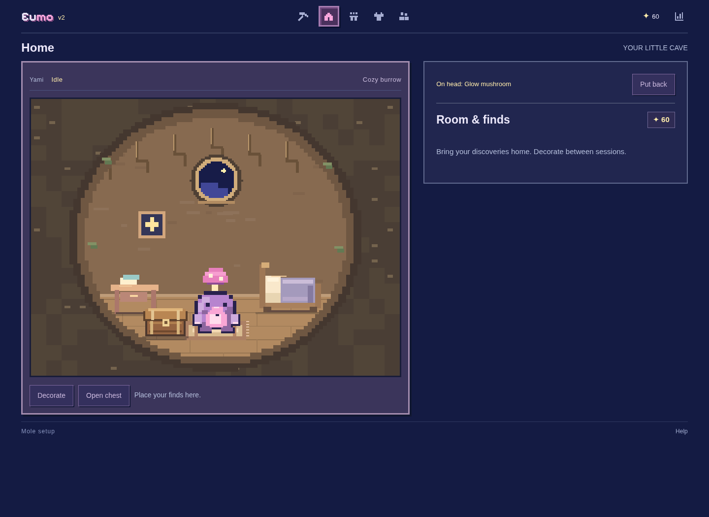
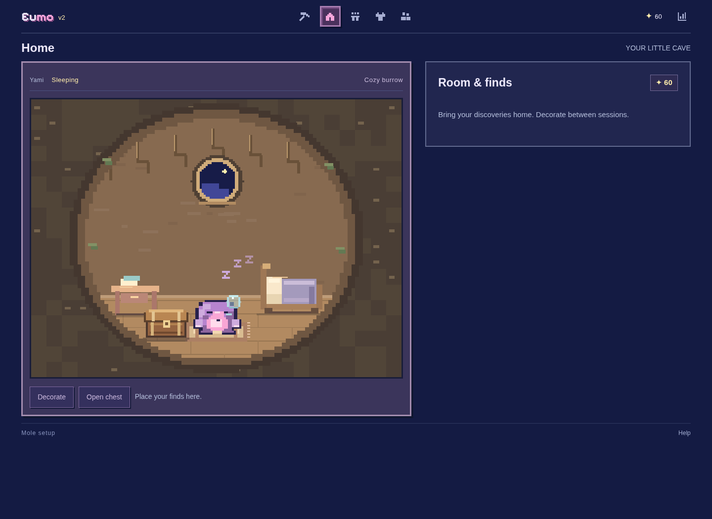

# Eumo v2

An English pixel focus companion. Study or work while an earless mole digs, automatically collects stars and finds, and brings discoveries home.

[中文 README](../README.md) · [Product details (Chinese)](PRODUCT.md)

## Download and run

Download the repository ZIP from GitHub, extract it, and open **dist/Eumo.html** in Chrome or Edge. The single file embeds all artwork, scripts, styles, a local Pixelify Sans font, and the creator-supplied Warm Focus MP3. No installation is required to play.

GitHub displays HTML source when browsing a file; download and open it locally, or enable GitHub Pages separately. No public deployment is claimed here.

## Features and rules

- Name and recolor your mole with 12 presets or a custom color; returning players go directly to Focus.
- Study and Work: 1 star per 5 active minutes, 1 find per 10 minutes, 1 metre per 30 seconds. Unused time carries across sessions. Pauses and Breaks do not earn rewards.
- Pickups sit on the tool's actual route. Ending early keeps recorded time, depth and collected rewards. No daily cap or continuous-session multiplier.
- The repeatable 15-second developer demo still earns **1 spendable star, 5 metres and 1 find**. It does not enter focus reports.
- Home is the second navigation icon: a round earthen burrow with scaled furniture and four placement spots. Open the wooden, slotted treasure chest, select a find and choose Display on head. Treasures balance on the mole’s head only in Home; they never appear in the mine or fitting preview.
- Idle blinking, drowsiness after about 90 seconds, sleep after about 5 minutes with rising pixel zzz, a nose bubble and visible breathing; pet to wake, jump, say `yeeeeee` and play two softened, voiced doo-doo syllables. No petting during sessions.
- The newly supplied Warm Focus (3) music plays only after pressing Music, loops across navigation, remembers volume and does not autoplay on reload.
- Optional task and outcome notes; Study/Work totals, trend, calendar, a prominent Finish action in the top-right Today page.
- Choose one of 7 hats, 5 clothes, 5 scarves and 6 glasses (five new styles plus the original goggles); mix categories with the legacy star pin. Six paid tools (45–240 stars) have distinct digging animations, with no reward or speed boost; the free default pickaxe is not a shop item. Device-local daylight changes the world. Companions are four clearly labelled sample profiles, not live players.

The fitting preview stays in the left panel while the right shop scrolls independently with a mouse wheel, draggable scrollbar, keyboard or touch. Categories remain accessible. On phones the preview becomes compact above the shop. Regular system fonts keep controls and timer digits readable; only the logo uses the bundled Pixelify Sans (SIL OFL 1.1). Small labels generally use 12–14px. Desktop layouts fit both available width and height at 100% zoom, keeping the full board and bottom controls visible. Desktop mine and timer panels use an approximately 72:28 split with aligned top/bottom edges. A lavender retro desktop chat window sits below the mine, with a pixel avatar, bevelled controls, an inset composer and keyboard-accessible collapse/expand. It supports user-initiated cloud chat via a Vercel proxy and a larger conversation window. Configure a provider key server-side before using real AI. Outfit and focus reactions remain local; shared game context is optional, and clearing chat preserves gameplay. No live-model validation or weight fine-tuning has been completed in this environment. Shorter screens compact and rearrange controls without distorting the canvas; timer digits stay at least 44px.

Finish saves the daily summary and returns the mole to the surface, preserving lifetime depth, time, stars and inventory. Viewing reports alone never resets the mine. A new device-local day starts at the surface once no session is active. Normal digging stays in root soil for the first two hours (240 metres), then reaches soft lavender stone at two hours, sand at 2.5 hours, slate at three hours, granite at four hours, crystal at five hours and basalt at six hours. Unreached layers never appear early beneath the viewport. The developer demo intentionally uses accelerated depth. Device time follows the local clock, including timezone and DST changes.

All progress is browser-local. No account, cloud sync, real multiplayer, or attention verification is implemented.

## Development

```sh
python3 -m http.server 8000
python3 scripts/build_standalone.py
```

The application has no runtime package dependencies. Browser checks require Python, Playwright and Chromium; optional reward invariants use Node.js. See [testing](TESTING.md) and [validation](VALIDATION.md).





Optional Qwen chat setup, model selection and persona prompts are documented in [AI_SETUP](AI_SETUP.md), [AI_RESEARCH](AI_RESEARCH.md) and [AI_PROMPTS](AI_PROMPTS.md). Static gameplay remains offline-capable; cloud chat requires the backend and a provider key.
