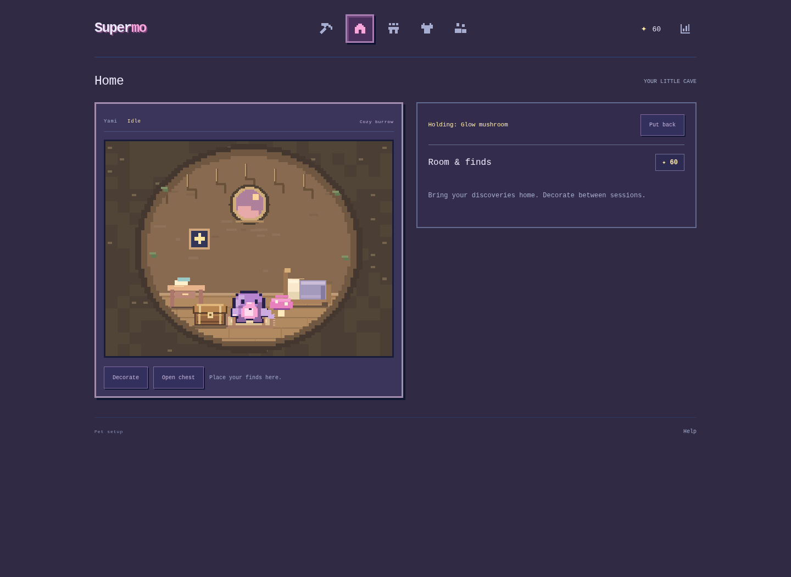
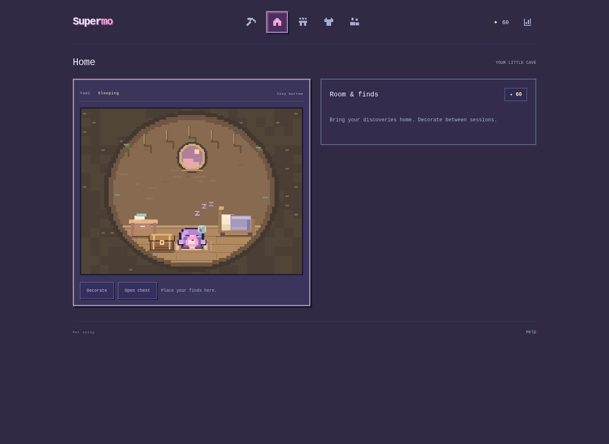

# Supermo

An English pixel focus companion. Study or work while an earless mole digs, automatically collects stars and finds, and brings discoveries home.

[中文 README](../README.md) · [Product details (Chinese)](PRODUCT.md)

## Download and run

Download the repository ZIP from GitHub, extract it, and open **dist/Supermo.html** in Chrome or Edge. The single file embeds all artwork, scripts, styles, and the creator-supplied Warm Focus MP3. No installation is required to play.

GitHub displays HTML source when browsing a file; download and open it locally, or enable GitHub Pages separately. No public deployment is claimed here.

## Features and rules

- Name and recolor your mole with 12 presets or a custom color; returning players go directly to Focus.
- Study and Work: 1 star per 5 active minutes, 1 find per 10 minutes, 1 metre per 30 seconds. Unused time carries across sessions. Pauses and Breaks do not earn rewards.
- Pickups sit on the tool's actual route. Ending early keeps recorded time, depth and collected rewards. No daily cap or continuous-session multiplier.
- The repeatable 15-second developer demo still earns **1 spendable star, 5 metres and 1 find**. It does not enter focus reports.
- Home is the second navigation icon: a round earthen burrow with scaled furniture and four placement spots. Open the pictured treasure chest to hold a find, put it back, or move it from a display spot.
- Idle blinking, drowsiness after about 90 seconds, sleep after about 5 minutes with rising pixel zzz, a nose bubble and visible breathing; pet to wake, jump, say `yeeeeee` and play two softened, voiced doo-doo syllables. No petting during sessions.
- The newly supplied Warm Focus (3) music plays only after pressing Music, loops across navigation, remembers volume and does not autoplay on reload.
- Optional task and outcome notes; Study/Work totals, trend, calendar, daily closing and JSON export in the top-right Today page.
- Multiple equipment items can be worn together. Device-local daylight changes the world. Companions are four clearly labelled sample profiles, not live players.

All progress is browser-local. No account, cloud sync, real multiplayer, or attention verification is implemented.

## Development

```sh
python3 -m http.server 8000
python3 scripts/build_standalone.py
```

The application has no runtime package dependencies. Browser checks require Python, Playwright and Chromium; optional reward invariants use Node.js. See [testing](TESTING.md) and [validation](VALIDATION.md).




