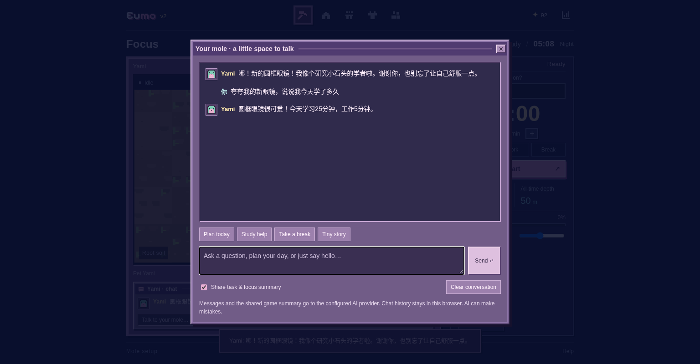
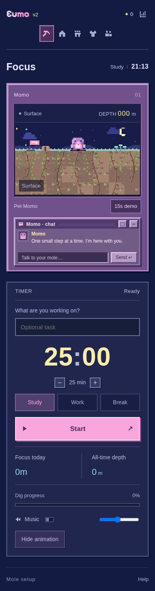

# Eumo v2 · 云端鼹鼠 AI 接口验证记录

验证日期：2026-10-22（Asia/Shanghai）。对象为当前源码、Node 接口和 `dist/Eumo.html`。环境：Python 3.12.14、Playwright 1.62.0、Chromium 154.0.8037.57、Node.js v24.19.0；Vercel 配置目标为 Node 22。

**真实服务商 Key 不存在，真实 Qwen 首聊、线上部署与模型质量评测尚未完成。** 下表的模型服务使用本地测试 fixture；它验证软件行为，不验证真实模型语气、解题正确性或建议质量。

## 实际执行

| 检查 | 结果 | 范围 |
| --- | --- | --- |
| `python scripts/build_standalone.py` | 通过 | CSS、十个 JS、原 MP3、字体和许可内嵌；重复生成一致，三个入口相同 |
| 十个浏览器 JS 与新增服务端/开发脚本的 `node --check` | 通过 | JavaScript 语法 |
| `node --test tests/test_ai.cjs` | 13 项通过 | 真实规则与物品目录、上下文关闭、Demo/Break 排除、system/tool 过滤、地址/模型不可由客户端更改、Key 隔离、限流、超时、错误和思考块处理 |
| `python tests/test_chat.py` | 通过 | 浏览器 → Node 代理 → 本地协议 fixture；换装无暗中调用、真实时间/任务/装备、多轮、IME、共享关闭、失败重试、纯文本 XSS、历史/清空、计时不中断、同源下载版和缺 Key 提示 |
| `python tests/test_entry.py` | 通过 | 两种受限 iframe、START/Enter、中文名称、受限 History、真实计时与无耳朵像素 |
| `python tests/test_site.py` | 通过 | 眨眼、抚摸/禁摸、叠穿与刷新、Study/Work/提前结束/跨午夜、报告、声音、旧存档与响应式 |
| `python tests/test_world.py` | 通过 | 实际角色颜色、命名、创建/取消/修改/刷新、四时段、设备时区、同伴和响应式 |
| `python tests/test_journey.py` | 通过 | 跨轮奖励与去重、真实路径拾取、Demo/Break 口径、家园、今日确认、音频波形与断网单文件 |
| `python tests/test_supermo.py` | 通过 | 宝箱数量/刷新、睡眠阈值/呼吸/鼻涕泡/唤醒、暂停、歌曲时长、实际地层与手机编辑 |
| `python tests/test_eumo.py` | 通过 | 服装分类/购买/互斥、旧存档、家园头顶展示、6 工具、奖励不变、商店独立滚动和字体 |
| `python tests/test_daily.py` | 通过 | Today 完成后返地面与立即重绘、取消/刷新/隐藏动画、保留成果、午夜/时区/DST、真实材质与响应式 |
| `python tests/test_viewport.py` | 通过 | 13 组桌面窗口/DPI × 三种状态，完整画面/计时/按钮/页脚，2.55:1 对齐与聊天窗口边界、紧凑间距、手机及断网交互 |
| `python tests/test_geology.py` | 通过 | 普通 120 分钟真实程序流程，119:59 前泥土、240m 才见石层、24 星/12 件结算、后续地层与返地面 |
| `node tests/test_rewards.js` | 通过 | 奖励阈值、拆轮等价、零头、无硬上限、Demo、Break、稳定事件 |
| `node scripts/export_sft.cjs` | 通过 | 20 条原创示范导出为 JSONL；系统提示词文本与真实服务端规则一致；不是权重训练 |
| `node scripts/evaluate_ai.cjs new-glasses` | 缺 Key，预期退出码 1 | 明确输出未执行真实模型评测；不创建假的质量报告 |
| 资源一致性与文档链接 | 通过 | 原 MP3/TTF 的 base64 解码字节一致、完整 OFL、无 Key/Authorization 头进入客户端、相对文档链接存在 |

十个浏览器脚本均获得退出码 0。长计时和日期变化使用加速时钟，只验证程序行为，不证明用户现实中专注。接口测试中的 13 项不能解读为“模型质量通过 13 项”。

## 界面证据






桌面窗口包含 2560×1320、2048×1050、1920×960、1680×860、1600×780、1536×730、1440×768、1366×650、1280×600、1024×640，另在 DPR 1.5 下复测三组。手机允许正常纵向滚动。

## 下载文件

```text
主入口: dist/Eumo.html
兼容入口: dist/Supermo.html、dist/LOOP_PET.html
字节数: 6130378
SHA-256: f4b57b623934d0989dfb41f381d1274c3d35ecc454270aaefe91a4eb8d19240c
MP3: Warm Focus (3).mp3, 194.520 秒
Logo 字体: Pixelify Sans variable TTF, 79160 字节, SIL OFL 1.1
```

同站提供的单文件可以访问该站 /api/chat；直接 file:// 不具有 Node 接口。游戏存储键沿用 loop-pet-soft-universe-v1，聊天使用独立键 eumo-mole-chat-v1；没有账号云同步或服务端聊天数据库。

## 尚未完成的外部验证

- 配置服务商真实 Key、核验模型 ID/账号额度、完成首次真实回复。
- 按独立的 16 条 rubric 人工评估真实模型的角色、事实、答题与日程质量。
- 核验 Vercel 线上部署。当前环境访问该域名的出站代理返回 CONNECT 403，不能据此判断网站是否可用。
- 未进行模型权重训练或 LoRA/SFT。当前只是系统提示、few-shot 示例与导出的种子数据。

离线测试通过本地 HTTP 加载后断网；受管理 Chromium 禁止 file:// 导航，没有声称在此环境验证双击文件。实例内限流不构成分布式全局成本上限，部署配置与边界见 [AI_SETUP](AI_SETUP.md)。
