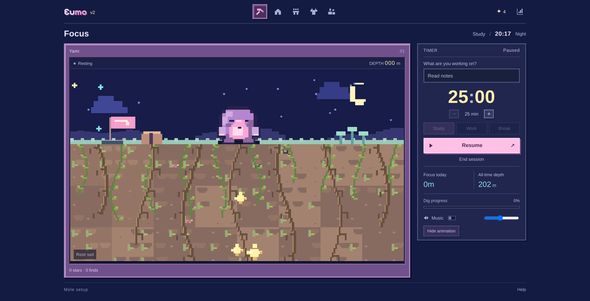
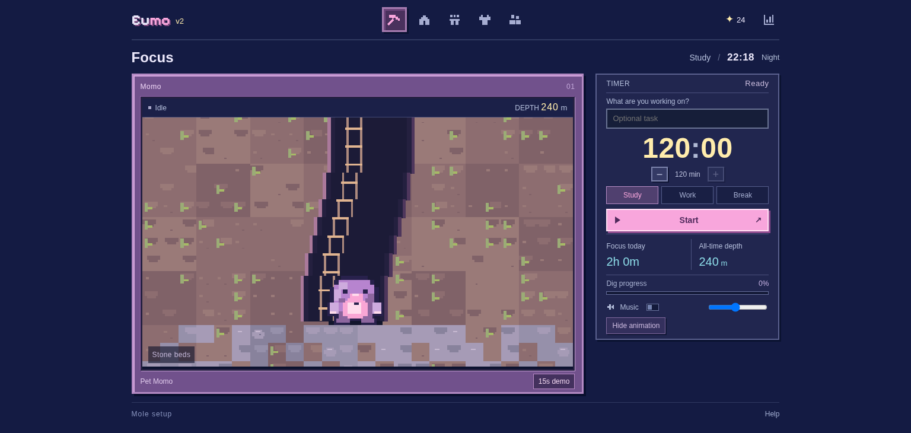

# Eumo v2 · 100% 屏幕适配与两小时土层验证记录

验证日期：2026-10-22（Asia/Shanghai）。对象是当前源码与 `dist/Eumo.html`，不是 GitHub Pages 部署。

环境：Python 3.12.14、Playwright 1.62.0、Chromium 154.0.8037.57、Node.js v24.19.0（仅开发检查）。

## 实际执行

| 检查 | 结果 | 范围 |
| --- | --- | --- |
| `python scripts/build_standalone.py` | 通过 | CSS、九个 JS、原 MP3 与 Pixelify Sans 字体/许可内嵌；重复生成内容一致 |
| 九个源码 JS 的 `node --check` | 通过 | JavaScript 语法 |
| `node tests/test_rewards.js` | 通过 | 阈值、跨轮等价、零头、Demo、Break 与稳定事件 |
| `python tests/test_entry.py` | 通过 | 受限 iframe、按钮/Enter、中文名称、History 限制和无耳朵像素 |
| `python tests/test_site.py` | 通过 | 眨眼、抚摸/跳跃/禁摸、叠穿、Study/Work、跨午夜、音频、报告和响应式 |
| `python tests/test_world.py` | 通过 | 创建/颜色、编辑、进度保留、四时段、时区与示例同伴 |
| `python tests/test_journey.py` | 通过 | 部分结算、刷新去重、Demo、家园、旧数据迁移、日终确认、断网单文件和双音节波形 |
| `python tests/test_supermo.py` | 通过 | 品牌、宝箱命中与头顶副本、刷新、困倦/睡眠边界、真实呼吸/鼻涕泡像素、唤醒、暂停区分、新歌时长、七种实际地层、手机宝箱和编辑 |
| `python tests/test_eumo.py` | 通过 | 7/5/5/6 件服装逐件价格与购买、分类互斥、旧配饰、家园专属头顶像素、木箱格子、6 工具逐件购买和实际动画像素、免费复用与默认工具、Demo 奖励和报告隔离、手机与矮屏、实际滚轮/拖动滚动条且左侧位置不变、眼镜实际像素、最小字号、离线字体 |
| `python tests/test_daily.py` | 通过 | 大屏与手机布局、常规计时文字、Mole 文案、移除 Export、大 Finish、取消/查看不重置、返地面及刷新、成果保留、次日/跨午夜、三时区分钟与 DST、真实较小眼睛、更新后的七种脚下材质；隐藏动画且 RAF 暂停后完成总结，真实 Canvas 立即返地面，恢复显示和刷新保存；断网单文件同样验证 |
| `python tests/test_viewport.py` | 通过 | 默认 100% 缩放，13 组桌面窗口/DPI × 待机/运行/暂停；整页无纵横滚动溢出，画面、计时、Start/End、底部控制和页脚完整可见；Canvas 比例不变，计时最低 44px |
| `python tests/test_geology.py` | 通过 | 实际运行 120 分钟 Study 程序流程，119:59 前实际画面仍为泥土，240 米才出现石层；0/120/230/239.999 米无提前露石，后续地层边界、24 星/12 件结算不变，日终仍返地面 |
| 音频及兼容副本 | 通过 | MP3 上传原件、资源和 base64 解码字节一致；TTF 与内嵌字体字节一致，完整 OFL 许可在单文件内；三个入口内容相同 |

九个浏览器脚本均已实际执行并获得退出码 0。`test_world.py` 首次并发执行在固定 200ms 等待后的颜色像素断言失败，单独完整复跑通过；这项旧测试仍依赖固定动画等待。时钟加速验证程序行为，不验证现实中的专注。

桌面窗口包含 2560×1320、2048×1050、1920×960、1680×860、1600×780、1536×730、1440×768、1366×650、1280×600、1024×640；另在 DPR 1.5 下复测 1680×860、1536×730、1280×600。手机和平板允许正常纵向滚动，不强行压缩到一屏。





## 下载文件

```text
主入口: dist/Eumo.html
兼容入口: dist/Supermo.html、dist/LOOP_PET.html
字节数: 6108122
SHA-256: 66119d189a2873a6105b0a3d8188856e3a6f7cea275c3dd50b1d1d84e3c89aed
MP3: Warm Focus (3).mp3, 194.520 秒
Logo 字体: Pixelify Sans variable TTF, 79160 字节, SIL OFL 1.1
```

旧入口供替换同一路径文件时使用；界面均为 Eumo v2。同一浏览器同一站点沿用原存储键；不同文件地址/文件夹的本地存储是否共享仍由浏览器决定，没有云同步。

## 验证边界

离线测试先由本地 HTTP 载入单文件，再断开网络，确认音乐与页面仍可使用。当前受管理 Chromium 禁止 file:// 导航，因此没有声称在此环境验证双击文件。访问用户提供的 Vercel 地址时，执行环境的出站代理返回 CONNECT 403，因此未核验该站的部署状态；不能据此判断站点是否可用。没有验证公网 Pages、实体手机全机型、所有浏览器，也没有真人联机。
