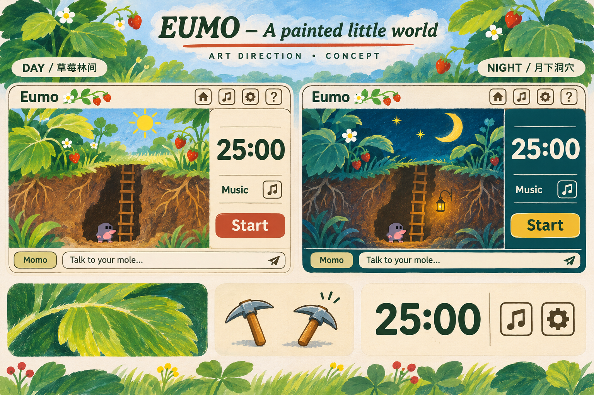

# Eumo 复古绘本方向 · 待确认参考

本文件是美术提案，不代表已经替换网页背景或调整功能。参考图由生成工具制作，用于讨论笔触、色彩和画面层次。图中的角色是占位示意，正式角色使用已恢复的旧版素材；导航图标、控件数量及聊天区尺寸以现有产品为准。

## 已完成的明确修正

- 倒计时恢复 `b3a2846` 的 Arial 字体、600 字重及数字间距规则。
- 鼹鼠绘制、配色、聊天头像和网站小图标恢复到 `b3a2846`。
- 桌面网页增加小锄头光标，点击点固定在锄头尖端；按下时轻微转动。文本框保持文本光标，不影响手机触摸。
- [实际倒计时截图](../images/eumo-restored-timer.png) / [实际角色截图](../images/eumo-restored-mole.png)。

## 上一版偏离参考的原因

1. 把“复古”集中到像素字体、嵌角边框、规则颗粒上，导致倒计时变难读；这些符号没有表现出插画的绘画过程。
2. 提取了绿、蓝、米色，却丢掉了颜料覆盖、干刷露底、同一片叶子里的冷暖变化，以及有分量的深色轮廓。大面积颜色显得轻薄。
3. 重复的矢量叶片和边角小花变成背景装饰，没能形成真正的林间环境。多个绿色框的重量接近，也削弱了画面与工具之间的主次。

## 从三张动画参考里读到的结构

这些画面更接近中欧老动画的绘本插画语言。就可见质感而言，背景有水粉覆盖、水彩晕染、干刷与彩铅线条的效果，角色则是清楚的描边和平涂。不能只用滤镜或噪点代替这些具体画法。

- **月夜图**：深蓝和青绿交叠，黄色月亮形成最大明度焦点；前景深叶与暖木头托住角色。夜色有冷暖关系。
- **洞穴卧室图**：米色洞壁留出大块安静空间，根系、木头、唱片机各有自己的材质。家具不靠统一圆角卡片来建立风格。
- **草莓图**：叶子有夸张比例、不同朝向和不规则轮廓，草莓红只点在少数位置。浅色背景与深浅绿穿插，让画面有空气。

“印象派的感觉”适合用在背景的光色变化：黄绿亮部与蓝绿暗部相邻、颜料色块相互透出。计时器、文字和操作图标保持准确轮廓与清晰对比。

## 下一版应如何落地

| 部位 | 方向 |
| --- | --- |
| 白天 | 暖白空间、层次丰富的草绿和瓶绿、少量草莓红；阳光通过叶片照到地表。避免大块浅薄的薄荷色。 |
| 夜间 | 普鲁士蓝、青绿与深叶影，月黄形成焦点，洞口少量暖光；单独绘制夜间光照，而非简单加黑。 |
| 场景 | 画植物、地表、根系和土层的连续关系；把细节放到环境中，文字附近留白。 |
| 操作层 | 干净纸面或安静深色底，边框减到必要层数。倒计时、开始按钮拥有明确优先级。 |
| 家装 | 木头端面、织物、洞壁分别绘制材质；保留现有家具和摆放方式。 |
| 图标 | 小幅手绘或像素图案放进紧凑方框，统一轮廓粗细；不增加重复文字。 |
| 反馈 | 小锄头按下、按钮下沉、选中描边即可。减少无意义漂浮、发光和粒子。 |

图里的简化界面只承担美术说明。正式制作继续保留任务、时长、模式、暂停/结束、音乐、数据、好友、聊天等现有功能；绘制插画素材后再做页面接入，不把生成图直接当成整张可点击网页。
